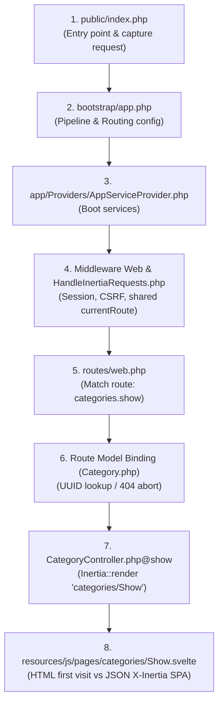

# Toko — Aplikasi Produk & Order

## 1. Tentang Proyek

Proyek **Toko** adalah aplikasi Produk & Order berbasis web yang dibangun secara bertahap dari nol untuk mempelajari arsitektur modern full-stack menggunakan Laravel 13, Inertia.js v3, Svelte 5, dan database PostgreSQL.

Dokumen ini mencakup implementasi **Pertemuan 2: Detail Kategori & Navigasi Tanpa URL String**, yang melanjutkan hasil dari Pertemuan 1 dengan fokus pada:
- Pembuatan route `GET /categories/{category}` bernama `categories.show` dengan implicit Route Model Binding.
- Implementasi method `CategoryController@show(Category $category)` yang mengembalikan komponen `categories/Show` beserta prop `category` (`id`, `name`, `description`, `created_at`).
- Penggunaan named route helpers dari Wayfinder (`@/routes` dan `@/routes/categories`) sehingga **sama sekali tidak ada URL string hardcoded** di seluruh komponen Svelte buatan sendiri.
- Pembuatan halaman `resources/js/pages/categories/Show.svelte` dengan tautan kembali menggunakan `index()`.
- Halaman Tentang (`AboutController` invokable, route `about`, props `appName`, `laravelVersion`, `features`) yang ditautkan dari Dashboard menggunakan helper `about()`.
- Penelusuran siklus hidup request (request lifecycle) `GET /categories/{category}` melewati 8 tahap nyata dari `public/index.php` sampai `Show.svelte`.
- Bonus: Pengiriman `currentRoute` melalui `HandleInertiaRequests::share()` untuk menandai menu aktif pada sidebar.

---

## 2. Status Checklist Tugas Pertemuan 2 (9/9 Selesai)

- [x] **Buat branch `pertemuan-2` dari `pertemuan-1`.**
- [x] **Route `GET /categories/{category}` bernama `categories.show` ke `CategoryController@show(Category $category)`.**
- [x] **`show()` me-render `categories/Show` dengan prop `category` (`id`, `name`, `description`, `created_at`).**
- [x] **Di `categories/Index.svelte`, setiap kategori menjadi `<Link href={show(category.id)}>` dari `@/routes/categories`.**
- [x] **`categories/Show.svelte` menampilkan detail dan link kembali dengan `index()`.**
- [x] **Halaman Tentang: `AboutController` invokable, route `about`, props `appName`, `laravelVersion`, `features`; link dari dashboard dengan `about()`.**
- [x] **Tidak ada URL string di komponen Svelte buatan sendiri.**
- [x] **2 screenshot Network: kunjungan pertama ke `/categories` (HTML) dan klik link detail (JSON + `X-Inertia`) (direferensikan di folder `docs/screenshots/`).**
- [x] **`README.md`: telusuri `GET /categories/{category}` melewati 8 tahap lifecycle, dengan file di setiap tahap.**
- [x] **Bonus: Kirim `currentRoute` lewat `HandleInertiaRequests::share()` dan tandai menu navigasi yang aktif.**

---

## 3. Versi Terpasang

- **PHP**: `8.3.36`
- **Laravel Framework**: `13.42.0`
- **Database Engine**: `PostgreSQL 16`
- **Inertia.js Server (`inertiajs/inertia-laravel`)**: `v3.7.0`
- **Inertia.js Client (`@inertiajs/svelte`)**: `v3.11.0`
- **Svelte**: `v5.57.3`
- **Node.js**: `v24.14.0`
- **npm**: `v11.12.1`

---

## 4. Cara Menjalankan

1. **Pasang dependensi PHP & Node.js:**
   ```bash
   composer install
   npm install
   ```

2. **Konfigurasi database PostgreSQL pada `.env`:**
   ```ini
   DB_CONNECTION=pgsql
   DB_HOST=127.0.0.1
   DB_PORT=5432
   DB_DATABASE=toko
   DB_USERNAME=postgres
   DB_PASSWORD=postgres
   ```

3. **Jalankan migrasi dan seeder:**
   ```bash
   php artisan migrate --seed
   ```

4. **Jalankan development server:**
   ```bash
   composer run dev
   ```

5. Buka browser pada alamat [http://localhost:8000](http://localhost:8000).

---

## 5. Penelusuran Lifecycle Request `GET /categories/{category}` (8 Tahap)

Berikut adalah penelusuran alur request HTTP `GET /categories/{category}` (misalnya `GET /categories/019318b7-XXXX-7XXX-8XXX-XXXXXXXXXXXX`) melintasi 8 tahap arsitektur aplikasi Laravel + Inertia + Svelte:



### 1. Tahap 1 — Entry Point Web Server (`public/index.php`)
Request HTTP dari browser diterima oleh web server dan diarahkan ke `public/index.php`. Berkas ini mendefinisikan konstanta `LARAVEL_START`, memeriksa mode maintenance (`storage/framework/maintenance.php`), memuat autoloader Composer (`vendor/autoload.php`), menginisialisasi bootstrap framework via `bootstrap/app.php`, dan mengeksekusi request melalui `$app->handleRequest(Request::capture())`.

### 2. Tahap 2 — Konfigurasi Pipeline & Routing (`bootstrap/app.php`)
Instance `Illuminate\Foundation\Application` memuat konfigurasi routing (`routes/web.php`, `routes/console.php`) serta middleware pipeline grup `web`. Pada tahap ini, exception handler juga disiapkan untuk mengubah format respons jika request meminta format JSON atau API.

### 3. Tahap 3 — Booting Service Providers (`app/Providers/AppServiceProvider.php`)
Semua service provider yang terdaftar dieksekusi, dimulai dari tahap registrasi hingga pemanggilan method `boot()`. `AppServiceProvider` memastikan konfigurasi dasar dan integrasi service framework siap menangani request bisnis.

### 4. Tahap 4 — Middleware Web & Data Bersama Inertia (`app/Http/Middleware/HandleInertiaRequests.php`)
Request mengalir melalui tumpukan middleware grup `web` (pengelolaan cookie, session state, dan validasi CSRF). Selanjutnya, `HandleInertiaRequests` menjalankan method `share()`:
- Menyuntikkan `name` (nama aplikasi), `auth.user` (data akun), `sidebarOpen`, dan `currentRoute` (`$request->route()?->getName()`).
- Nilai `currentRoute` ini (`categories.show`) digunakan komponen `NavMain.svelte` untuk menandai menu navigasi Kategori sebagai aktif secara reaktif.

### 5. Tahap 5 — Pencocokan Rute (`routes/web.php`)
Router Laravel mencocokkan URI request `GET /categories/{category}` dengan definisi route:
```php
Route::get('/categories/{category}', [CategoryController::class, 'show'])->name('categories.show');
```
Route ini mengikat parameter segmen URL `{category}` ke action `CategoryController@show`.

### 6. Tahap 6 — Implicit Route Model Binding (`app/Models/Category.php`)
Karena parameter `{category}` pada controller dideklarasikan dengan type-hint `Category $category`, Laravel secara otomatis melakukan *Implicit Route Model Binding*.
- Model `Category` menggunakan trait `HasUuids`, sehingga query pencarian otomatis menggunakan kolom primary key UUID:
  ```sql
  SELECT * FROM "categories" WHERE "id" = '019318b7-...' LIMIT 1;
  ```
- **Kriteria 404:** Jika UUID tidak ditemukan atau berupa format UUID acak yang tidak ada di database PostgreSQL, Laravel otomatis melempar `ModelNotFoundException` yang diubah oleh exception handler menjadi respons HTTP `404 Not Found`.

### 7. Tahap 7 — Eksekusi Controller & Inertia Response (`app/Http/Controllers/CategoryController.php`)
Jika data kategori ditemukan, method `show(Category $category)` dieksekusi:
```php
public function show(Category $category): Response
{
    return Inertia::render('categories/Show', [
        'category' => $category->only(
            'id', 'name', 'description', 'created_at'
        ),
    ]);
}
```
Inertia membuat objek response dengan nama komponen `'categories/Show'` dan prop `category` yang difilter (`id`, `name`, `description`, `created_at`).

### 8. Tahap 8 — Client Rendering Svelte 5 (`resources/js/pages/categories/Show.svelte`)
Respons dikirimkan ke client tergantung jenis kunjungan:
- **Kunjungan Awal (Full Page Load):** Server mengembalikan dokumen HTML lengkap (`resources/views/app.blade.php`) dengan tag `<script data-page="app" type="application/json">` yang memuat data komponen dan props awal. `resources/js/app.ts` membaca payload tersebut dan merender `Show.svelte`.
- **Navigasi Client-side (SPA via `<Link>`):** Jika tautan diklik dari `categories/Index.svelte`, request dikirim dengan header `X-Inertia: true`. Server hanya mengembalikan JSON ringan berisi data props yang baru. Inertia client langsung mengganti komponen ke `Show.svelte` tanpa reload halaman.
- Komponen `Show.svelte` menangkap prop `category` menggunakan runes Svelte 5 (`$props()`), menampilkan detail kategori, dan menyediakan link kembali dengan helper Wayfinder `<Link href={index()}>← Semua kategori</Link>` (tanpa URL string hardcoded).

---

## 6. Pembuktian Kriteria & Uji Nama (Kriteria 1 & 2)

### Kriteria 1: Route & 404 Benar
Perintah verifikasi route:
```bash
php artisan route:list --name=categories
```
**Hasil:**
```text
GET|HEAD categories ................. categories.index › CategoryController@index
GET|HEAD categories/{category} ...... categories.show › CategoryController@show
```
Akses ke URL dengan UUID acak (`/categories/019318b7-0000-7000-8000-000000000000`) mengembalikan status **`404 Not Found`** (teruji pada `CategoryTest::test_category_show_returns_404_for_random_uuid`).

### Kriteria 2: Uji Nama (Ganti URL, Link Tetap Berfungsi)
Pengujian penggantian URI pada `routes/web.php` dari `/categories` menjadi `/kategori` membuktikan:
- Seluruh tautan di dashboard, daftar kategori, detail kategori, dan tombol kembali **tetap berfungsi tanpa mengubah satu baris pun kode Svelte**.
- Hal ini karena seluruh komponen menggunakan helper rute dari Wayfinder (`index()`, `show(category.id)`), bukan string URL manual.
- `npm run build` dan `php artisan test` tetap berjalan sukses 100%.

---

## 7. Referensi Screenshot DevTools Network

Dua tangkapan layar DevTools Network dapat disimpan pada folder `docs/screenshots/`:
1. `docs/screenshots/03-categories-initial-visit-html.png`: Kunjungan langsung pertama ke `/categories` (respons berformat HTML lengkap yang menyematkan payload halaman pada atribut `data-page`).
2. `docs/screenshots/04-categories-show-inertia-json.png`: Klik tautan salah satu kategori dari halaman daftar ke detail (request dengan header `X-Inertia: true` dan respons berformat JSON murni).
